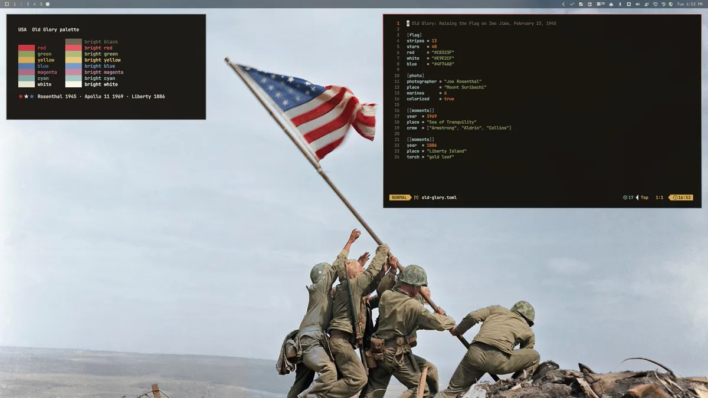
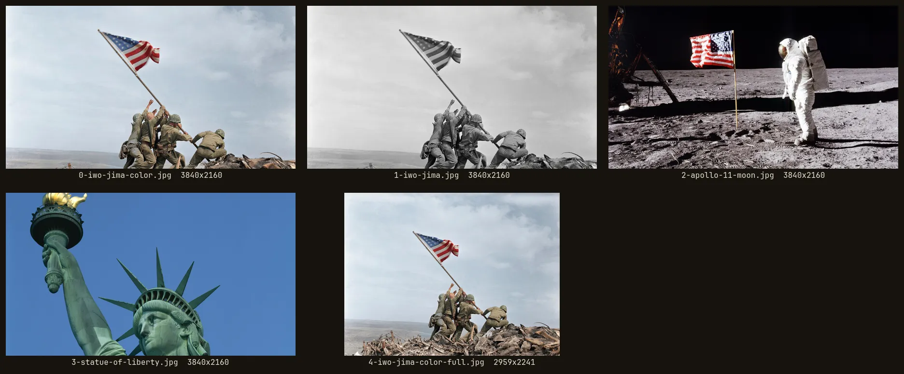

# USA

Repo: [stevederico/omarchy-usa-theme](https://github.com/stevederico/omarchy-usa-theme).

Omarchy theme from *Raising the Flag on Iwo Jima*, Joe Rosenthal, February 23, 1945, colorized.

Sister themes: [Space](https://github.com/stevederico/omarchy-space-theme) and [Burn](https://github.com/stevederico/omarchy-burn-theme).

Vintage Americana. Field-khaki black, parchment text, Old Glory red, faded canton blue. Red, white and blue active border.





## Palette

| Role | Hex |
|------|-----|
| Background | `#16130E` |
| Card | `#24201A` |
| Text (parchment) | `#E9E2CF` |
| Accent (Old Glory red) | `#C8323F` |
| Canton blue | `#4F74A8` |
| Brass | `#D4A94F` |
| Olive drab | `#8A9A5B` |
| Muted | `#6B604E` |

Omarchy generates the Hyprland, terminal, and editor configs from `colors.toml`, so the theme ships no `hyprland.lua`.

## Install

```bash
omarchy theme install https://github.com/stevederico/omarchy-usa-theme
```

Installs as `usa` and applies it right away.

Or install as a user theme from a checkout:

```bash
mkdir -p ~/.config/omarchy/themes/usa
cp -a colors.toml shell.toml icons.theme keyboard.rgb preview.png backgrounds \
  ~/.config/omarchy/themes/usa/
omarchy theme set usa
```

Backgrounds cycle with Super+Ctrl+Space.

## Backgrounds

| File | Size | Shot | Source |
|------|------|------|--------|
| `0-iwo-jima-color.jpg` | 3840×2160 (4K) | Iwo Jima flag raising, colorized, 16:9 crop **(default)** | [Commons](https://commons.wikimedia.org/wiki/File:Raising_the_Flag_on_Iwo_Jima,_larger_-_edit1.jpg) |
| `1-apollo-11-moon.jpg` | 3840×2160 (4K) | Buzz Aldrin and the flag, Apollo 11, 1969 (AS11-40-5875) | [Commons](https://commons.wikimedia.org/wiki/File:Buzz_Aldrin_and_the_US_flag_on_the_Moon,_AS11-40-5875.jpg) |
| `2-statue-of-liberty.jpg` | 3840×2160 (4K) | Statue of Liberty torch and crown, blue sky | [Commons](https://commons.wikimedia.org/wiki/File:Statue_of_Liberty,_New_York,_New_York_LCCN2011630662.tif) |

Iwo Jima was colorized with Grok Imagine. Its color was then laid on the original full-resolution luminance in Lab, so every detail is Rosenthal's and only the color is the model's. A face the model invented beside the leftmost Marine was neutralized back to sky.

Credits, all listed public domain on Wikimedia Commons:

- Iwo Jima: Joe Rosenthal / Associated Press, 1945
- Apollo 11: NASA, 1969
- Statue of Liberty: Carol M. Highsmith, Library of Congress
